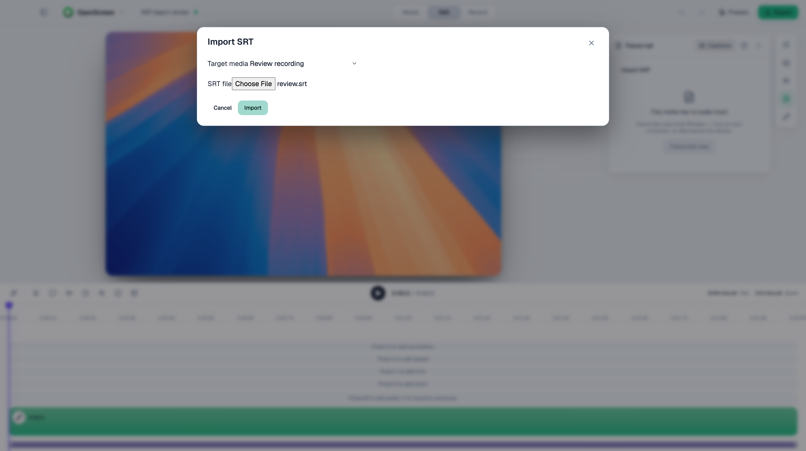
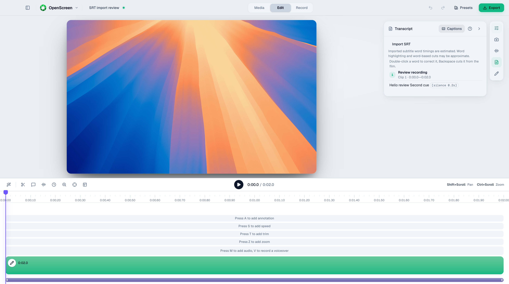
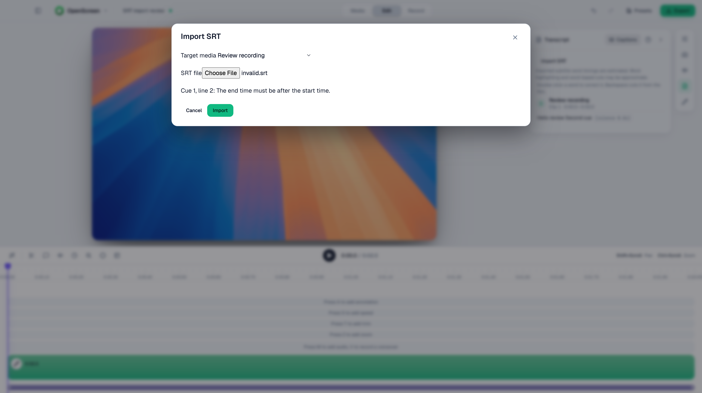

# SRT import review evidence

Source: `c404712946fe0c5e77adbdf990a711c644b1a4ce` on `codex/srt-import`, based on upstream `42a776ef`.

Captured on 2026-11-18 (Asia/Shanghai), macOS 26.4 arm64, Electron 41.2.1, Node 22.22.1 / npm 10.9.4.

Playwright drove the actual Electron renderer with an isolated profile and a seeded silent two-second recording fixture. `setInputFiles` selected real SRT bytes; document writes and reads used the actual native bridge and disk persistence. Screenshots are unmodified.

Verified import, one-step Undo/Redo, replacement cancel, cue/line validation preserving existing text, confirmed replacement and one-step Undo, full process restart with cues/timeline retained. The import dialog has no timestamp hints; its backdrop covers the viewport.

Computer-use MCP was unavailable. OS pointer/keyboard input and the native OS file-picker UI were not exercised. The native compositor addon was absent; no caption-pixel, playback/export, capture/webcam/tray or Windows/Linux runtime validation is claimed.

Full unit suite: 409 files, 5,820 passed, 2 skipped. Both app/test TypeScript checks, lint (36 existing warnings), 17-locale i18n, docs and renderer/main/preload build passed. Independent code review found no remaining important issues.

